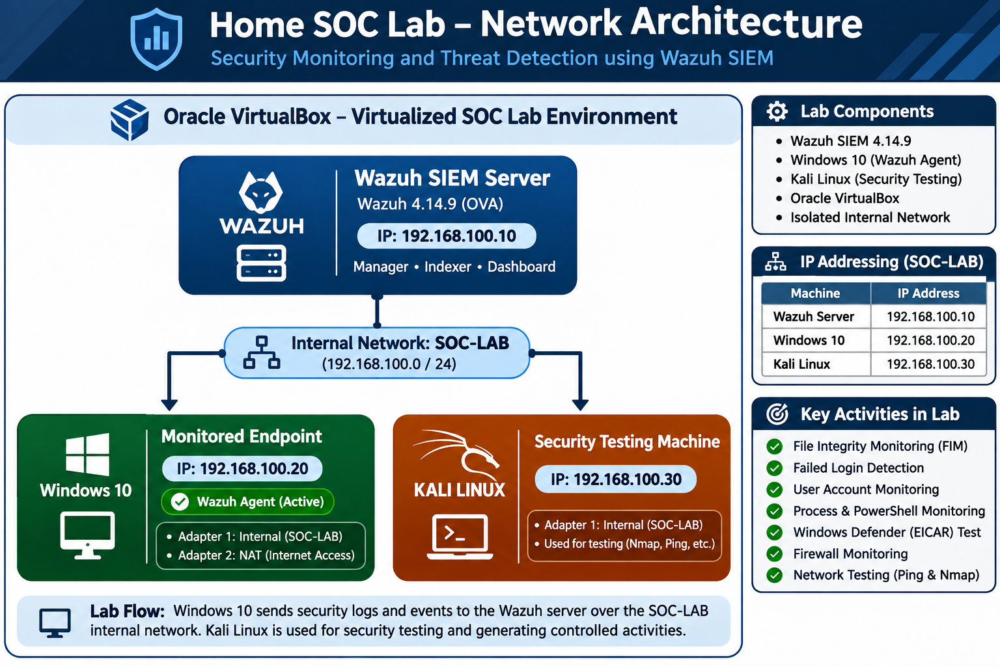

# Home SOC Lab – Security Monitoring and Threat Detection

## 1. Project Overview

This project demonstrates the implementation of a hands-on Security Operations Center (SOC) lab using Wazuh SIEM, Windows 10, and Kali Linux in a virtualized environment.

The primary objective was to configure endpoint monitoring, collect and analyse security events, investigate SIEM alerts, and perform controlled security testing to understand fundamental SOC operations.

## 2. Lab Architecture

The following diagram illustrates the Home SOC Lab architecture, including the VirtualBox environment, internal network, IP addressing, and communication between the Wazuh SIEM server, Windows 10 endpoint, and Kali Linux testing machine.

## 2. Lab Environment

| Component | Configuration |
|---|---|
| SIEM Platform | Wazuh 4.14.9 |
| Monitored Endpoint | Windows 10 |
| Security Testing Machine | Kali Linux |
| Virtualization Platform | Oracle VirtualBox |
| Network Configuration | VirtualBox Internal Network – SOC-LAB |
| Wazuh IP Address | 192.168.100.10 |
| Windows 10 IP Address | 192.168.100.20 |
| Kali Linux IP Address | 192.168.100.30 |

## 3. Tools and Technologies

- **Wazuh SIEM:** Security event collection, alert monitoring, and endpoint visibility.
- **Windows 10:** Monitored endpoint for security event generation.
- **Kali Linux:** Network connectivity and reconnaissance testing.
- **Nmap:** TCP port scanning and service discovery.
- **Microsoft Defender Antivirus:** Endpoint threat detection and remediation.
- **Windows Event Viewer:** Reviewing Windows security and Defender events.
- **Oracle VirtualBox:** Creating and managing the virtual lab environment.

## 4. Security Monitoring and Testing Activities

The following activities were performed in the controlled lab environment:

1. **File Integrity Monitoring (FIM):** Monitored file creation and modification events on the Windows endpoint.
2. **Failed Login Monitoring:** Generated failed authentication attempts and reviewed the corresponding Wazuh alerts.
3. **User Account Monitoring:** Created a test user account and verified account creation events.
4. **Process Monitoring:** Monitored process creation events, including application execution.
5. **PowerShell Activity Monitoring:** Generated PowerShell-related process activity and reviewed endpoint events.
6. **Microsoft Defender Monitoring:** Performed the EICAR antivirus test and reviewed threat detection and remediation events.
7. **Network Reconnaissance:** Tested network connectivity and performed TCP port scanning against the Windows endpoint using Kali Linux and Nmap.
8. **Firewall Event Monitoring:** Observed firewall-drop correlation alerts in Wazuh and reviewed Windows firewall logs.

## 5. Key Results and Findings

- Successfully connected the Windows 10 endpoint to the Wazuh SIEM platform.
- Detected file creation and modification activities through File Integrity Monitoring.
- Identified failed authentication attempts through Wazuh alerts.
- Detected test user account creation activity.
- Collected process creation events, including application and PowerShell-related activity.
- Microsoft Defender detected the EICAR test file. Detection and remediation events were visible in Windows Event Viewer and Wazuh.
- Nmap identified the Windows endpoint as reachable, while all 100 scanned TCP ports were reported as filtered.
- Observed firewall-drop correlation alerts in Wazuh.

## 6. Limitations

- The lab uses a small virtualized environment rather than an enterprise production network.
- Dedicated Wazuh detection of the Nmap scan was not confirmed.
- Direct ingestion of the raw Windows firewall log file into Wazuh was not fully verified.
- Complete process command-line capture was not confirmed.

## 7. Project Documentation and Evidence

The repository includes the detailed project report and supporting screenshots.

- **Project Report:** [Home SOC Lab Project Report](docs/Home-SOC-Lab-Project-Report-Final-v2.pdf)
- **Supporting Evidence:** [View Evidence Directory](evidence/)

The evidence is organised into folders covering:

- Lab architecture and network configuration
- Wazuh dashboard and agent status
- File Integrity Monitoring
- Failed login detection
- User account monitoring
- Process and PowerShell activity
- Windows Defender EICAR testing
- Firewall monitoring
- Kali Linux and Nmap testing

## 8. Learning Outcomes

Through this project, I gained practical exposure to:

- SIEM deployment and configuration using Wazuh.
- Endpoint onboarding and security event collection.
- Monitoring and analysing security alerts.
- Windows security event investigation.
- File integrity and authentication monitoring.
- Basic network reconnaissance using Nmap.
- Reviewing antivirus detection and remediation events.
- Documenting security investigations and lab findings.

## 9. Disclaimer

This project was developed for educational and defensive cybersecurity learning purposes in a controlled virtual environment. All security testing activities were performed on systems under my control.
